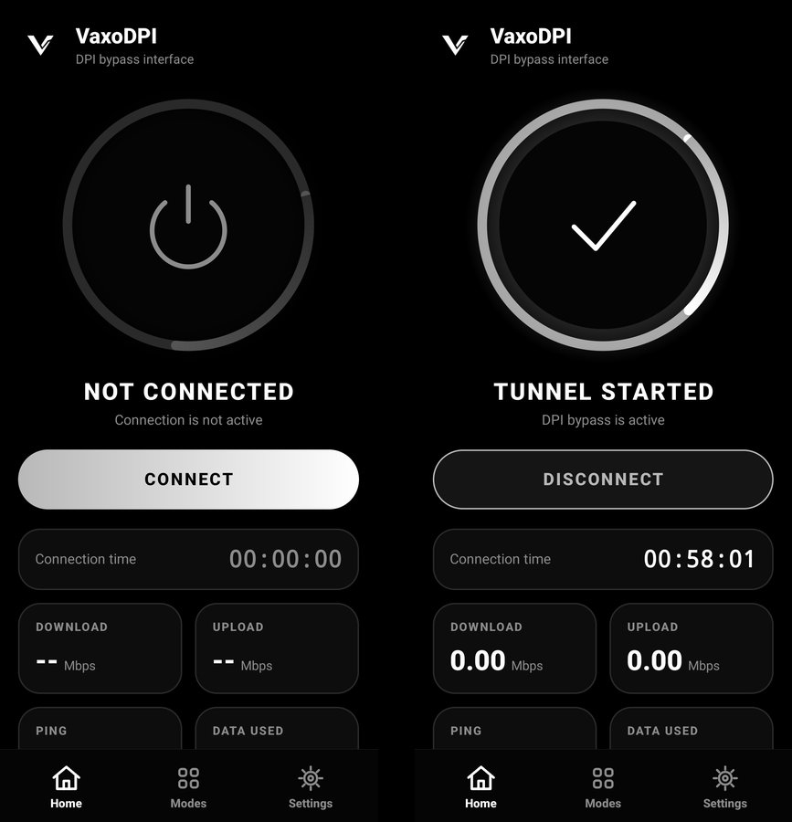

# VaxoDPI

**English** · [Türkçe](#türkçe) · [Русский](#русский)

[](https://github.com/valehhdoth/VaxoDPI/releases/latest)
[](LICENSE)
[](https://github.com/valehhdoth/VaxoDPI/stargazers)

Android DPI bypass app. Open blocked sites and apps on networks that use deep packet inspection. No root, no remote server, no account, no analytics.

**Website:** [vaxodpi.valeh.xyz](https://vaxodpi.valeh.xyz) · **Download:** [latest release](https://github.com/valehhdoth/VaxoDPI/releases/latest)

<p align="center"></p>

## Features

- One tap connect and disconnect, also from the notification
- Own SOCKS5 engine written in Java (VaxoProxy), no remote VPN server, your IP does not change
- Bypass is applied only to servers that appear to be blocked, so other sites are not slowed down
- Three strategies: Default, Split, Disorder
- Per-app selection with search: send only the apps you choose through the tunnel
- DNS selection: Cloudflare, Google, Quad9, AdGuard
- Live connection time, speed, ping and data used
- Optional local log, off by default. It never records sites or IP addresses
- Update check against GitHub Releases
- Black and white interface in English, Türkçe and Русский
- Signed releases built by GitHub Actions

## How it works

Android VpnService passes device traffic to the [HEV Socks5 Tunnel](https://github.com/heiher/hev-socks5-tunnel), which forwards it to VaxoProxy listening on `127.0.0.1`. For HTTPS connections VaxoProxy splits the TLS record and TCP segments (and can send a low-TTL first fragment), so DPI systems cannot recognize the connection. Traffic then goes directly to the site.

## Install

1. Download `app-release.apk` from the [latest release](https://github.com/valehhdoth/VaxoDPI/releases/latest).
2. Open it and allow installation from this source.
3. Android may show a Play Protect warning because the app is signed but not on the Play Store. Tap **More details**, then **Install anyway**.
4. Open VaxoDPI and tap **Connect**.

If a site does not open, pick another strategy in **Modes**, then reconnect. Results depend on your operator, so no strategy is guaranteed to work everywhere.

## Build from source

Requires JDK 17, Android SDK 35 and NDK `27.2.12479018`.

```
git clone https://github.com/valehhdoth/VaxoDPI
cd VaxoDPI
./gradlew assembleDebug
```

## Privacy

No accounts, analytics or ads. There is no VaxoDPI server. See the [privacy policy](https://vaxodpi.valeh.xyz/privacy.html).

## Credits and license

- Tunnel: [HEV Socks5 Tunnel](https://github.com/heiher/hev-socks5-tunnel) by heiher, MIT License. Its notice is in [THIRD_PARTY_NOTICES.md](THIRD_PARTY_NOTICES.md).
- VaxoDPI is released under the [MIT License](LICENSE).

## Disclaimer

Use VaxoDPI in accordance with the laws of your country. The software is provided "as is", without warranty of any kind.

## Contact

Valeh · [valeh.xyz](https://valeh.xyz) · valehxyz@gmail.com · Discord: valeh.xyz

---

## Türkçe

Android için DPI atlatma uygulaması. Derin paket incelemesi (DPI) uygulanan ağlarda engellenen site ve uygulamaları açar. Root yok, uzak sunucu yok, hesap yok, analitik yok.

**Özellikler:** tek dokunuşla bağlan/kes (bildirimden de), Java ile yazılmış kendi SOCKS5 motoru (VaxoProxy), yalnızca engelli görünen sunuculara atlatma, üç strateji (Varsayılan, Split, Disorder), aramalı uygulama seçimi, DNS seçimi (Cloudflare, Google, Quad9, AdGuard), canlı hız/ping/veri bilgisi, varsayılan olarak kapalı yerel log, güncelleme kontrolü, İngilizce/Türkçe/Rusça arayüz.

**Kurulum:** [Son sürümden](https://github.com/valehhdoth/VaxoDPI/releases/latest) `app-release.apk` dosyasını indir ve aç. Play Protect uyarırsa **Daha fazla ayrıntı**, sonra **Yine de yükle**'ye dokun. Uygulamayı açıp **Bağlan**'a bas. Bir site açılmazsa **Modlar**'dan başka strateji seçip yeniden bağlan. Sonuç operatöre göre değişir, her yerde çalışacağı garanti edilmez.

**Gizlilik:** Hesap, analitik ve reklam yok. VaxoDPI sunucusu yok. Ayrıntılar [gizlilik politikasında](https://vaxodpi.valeh.xyz/privacy.html). Kullanımda ülkenin yasalarına uymak sana aittir. Yazılım "olduğu gibi" sunulur.

---

## Русский

Приложение для Android для обхода DPI. Открывает заблокированные сайты и приложения в сетях с глубоким анализом пакетов. Без root, без удалённого сервера, без аккаунта и аналитики.

**Возможности:** подключение и отключение одним нажатием (в том числе из уведомления), собственный SOCKS5-движок на Java (VaxoProxy), обход только для серверов, которые выглядят заблокированными, три стратегии (Default, Split, Disorder), выбор приложений с поиском, выбор DNS (Cloudflare, Google, Quad9, AdGuard), скорость, пинг и трафик в реальном времени, необязательный локальный журнал (по умолчанию выключен), проверка обновлений, интерфейс на английском, турецком и русском.

**Установка:** скачайте `app-release.apk` из [последнего релиза](https://github.com/valehhdoth/VaxoDPI/releases/latest) и откройте его. Если Play Protect предупредит, нажмите «Подробнее», затем «Всё равно установить». Откройте VaxoDPI и нажмите «Подключить». Если сайт не открывается, выберите другую стратегию в разделе «Режимы» и переподключитесь. Результат зависит от оператора, работа везде не гарантируется.

**Конфиденциальность:** без аккаунтов, аналитики и рекламы, сервера VaxoDPI нет. Подробнее в [политике конфиденциальности](https://vaxodpi.valeh.xyz/privacy.html). Соблюдать законы своей страны должны вы сами. Программа предоставляется «как есть».
